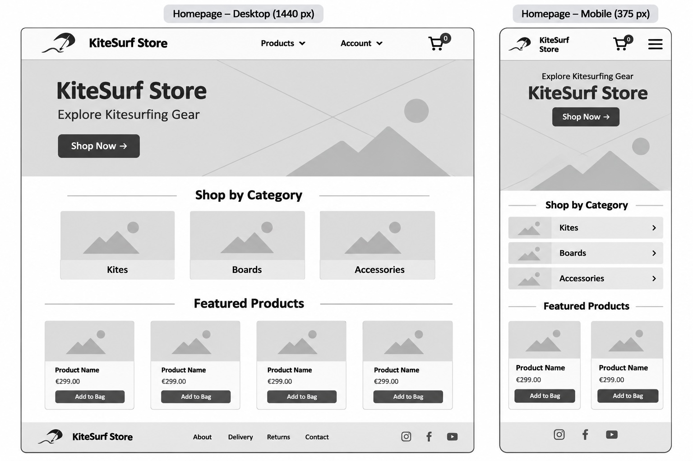
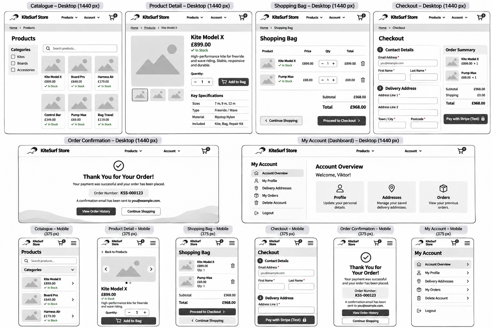

# KiteSurf Store — Kitesurfing Equipment E-commerce Website

**Project Status:** In Development

**Live Website:** To be added after deployment.

## Overview

KiteSurf Store is a planned full-stack e-commerce web application for customers in the United Kingdom who want to browse and purchase kitesurfing equipment online.

The website aims to provide a straightforward shopping experience, allowing customers to explore equipment categories, search and filter products, view detailed product information, manage a shopping cart and complete purchases securely as guests or registered customers.

Payments will be simulated using Stripe Test Mode, as KiteSurf Store is an educational demonstration project that does not process real payments or fulfil physical orders.

Registered customers will be able to view and update their profiles, manage saved delivery addresses, review previous orders and delete their accounts. Product catalogue administration will use Django Admin; a separate staff dashboard is outside the initial project scope.

KiteSurf Store is being developed as an original Django application for the **Gateway Qualifications Level 5 Diploma in Web Application Development — Unit 4: Full Stack Frameworks with Django (F/650/3528)**.

---

## Table of Contents

1. [Project Goals](#project-goals)
2. [Target Audience](#target-audience)
3. [User Stories and Prioritisation](#user-stories-and-prioritisation)
4. [Five Planes of UX](#five-planes-of-ux)

Additional sections will be added as the project develops.

---

## Project Goals

### Project Purpose

KiteSurf Store is a planned full-stack e-commerce website focused on selling kitesurfing equipment to customers in the United Kingdom.

The aim of the project is to create an accessible, responsive and user-friendly online store that makes it easy for customers to find suitable equipment and complete simulated purchases online.

The project will be developed as an original Django application for Unit 4: Full Stack Frameworks with Django.

### User Goals

- Browse kitesurfing equipment online.
- Find products through clear navigation and product categories.
- Search and filter products.
- Access detailed product information.
- Check product availability.
- Add products to a shopping cart.
- Manage shopping cart contents.
- Complete simulated purchases securely as a guest or registered customer.
- Receive clear feedback about payments and orders.
- Register, verify an email address and recover account access.
- Manage personal account information.
- View previous orders.
- Use the website on mobile, tablet and desktop devices.

### Site Owner Goals

- Present kitesurfing equipment through a professional online storefront.
- Organise products into relevant categories.
- Maintain accurate product information and prices.
- Manage catalogue data through Django Admin.
- Remove discontinued products from the active catalogue.
- Preserve historical order information.
- Keep reliable records of customer orders.
- Provide customers with a straightforward purchasing experience.

### Project Objectives

- Design an intuitive and responsive user interface.
- Develop an original full-stack application using Django.
- Design a relational database to support the store's functionality.
- Implement appropriate user authentication and access controls.
- Provide validated customer-facing CRUD for saved delivery addresses.
- Allow customers to view and update their profiles and delete their accounts securely.
- Integrate simulated online payment processing using Stripe Test Mode.
- Support guest checkout and registered customer checkout.
- Provide email verification, password recovery and order confirmation emails.
- Apply testing throughout development.
- Deploy the completed application to a cloud hosting platform.

---

## Target Audience

KiteSurf Store is aimed at people in the United Kingdom who are interested in purchasing kitesurfing equipment online.

The website is designed with three main customer groups in mind.

### Beginner Kitesurfers

People who are new to kitesurfing and may need additional information before purchasing equipment.

Their main needs include:

- Clear product descriptions.
- Easy navigation between equipment categories.
- Visible prices and product availability.
- A straightforward purchasing process.

### Experienced Kitesurfers

Customers who already understand their equipment requirements and want to find suitable products efficiently.

Their main needs include:

- Quick access to specific equipment.
- Product search and filtering.
- Detailed product specifications.
- An efficient checkout process.

### Returning Customers

Customers who have previously purchased equipment and may want to shop again.

Their main needs include:

- Convenient access to their accounts.
- Easy management of personal information and saved delivery addresses.
- Access to previous orders.
- A consistent shopping experience.

### Business Users

Authorised store staff will maintain the demonstration catalogue using Django Admin. Their needs include accurate product listings, pricing and stock information. A separate staff management dashboard is outside the initial project scope.

### Design Considerations

The needs of these user groups will guide the website's design and development.

The interface will aim to provide clear navigation, readable content, accessible controls and responsive layouts across different screen sizes.

---

## User Stories and Prioritisation

User stories define the planned functionality of KiteSurf Store from the perspective of visitors and registered customers.

The requirements are prioritised using the MoSCoW method:

- **Must Have:** Essential functionality required for the application.
- **Should Have:** Important improvements that support the user experience.
- **Could Have:** Optional features that may be implemented if time allows.
- **Won't Have:** Features excluded from the current project scope.

### Must Have

| ID | User Story |
|---|---|
| US01 | As a visitor, I want to browse products so that I can explore the available kitesurfing equipment. |
| US02 | As a visitor, I want to view product details so that I can make informed purchasing decisions. |
| US03 | As a customer, I want to add products to a shopping cart so that I can purchase multiple items together. |
| US04 | As a customer, I want to update quantities and remove products from my cart so that I can control my order. |
| US05 | As a customer, I want to see my order total so that I know how much I will pay. |
| US06 | As a customer, I want to complete a secure simulated online payment so that I can purchase equipment through the demonstration checkout. |
| US07 | As a customer, I want to receive confirmation of successful or unsuccessful payments so that I know the status of my purchase. |
| US08 | As a visitor, I want to register an account so that I can access customer-specific features. |
| US09 | As a registered customer, I want to log in and log out securely so that I can protect my account. |
| US10 | As a registered customer, I want to view and update my profile so that my contact information remains accurate. |
| US11 | As a registered customer, I want to view my previous orders so that I can keep track of my purchases. |
| US12 | As a registered customer, I want to add a delivery address so that I can reuse it during checkout. |
| US13 | As a registered customer, I want to view and edit my saved delivery addresses so that they remain accurate. |
| US14 | As a registered customer, I want to delete an unused delivery address so that I can manage my saved information. |
| US15 | As a registered customer, I want to delete my account securely so that I can stop using the service. |
| US16 | As a user, I want clear validation messages so that I can correct invalid information. |
| US17 | As a user, I want the website to work on different screen sizes so that I can shop using my preferred device. |
| US18 | As a visitor, I want to search for products by name so that I can find specific equipment quickly. |
| US19 | As a visitor, I want to filter products by category so that I can narrow down the catalogue. |
| US20 | As a customer, I want to see product availability so that I know whether an item can be purchased. |
| US21 | As a customer, I want my shopping cart to persist while browsing so that I do not lose selected products. |
| US24 | As a visitor, I want registration and login pages to be available only when I am logged out so that the authentication process is clear and appropriate to my current session. |
| US25 | As a customer, I want my personal information and order history to be accessible only to me so that other customers cannot view my private data. |
| US26 | As a customer, I want to complete checkout either as a guest or as a registered user so that I can choose whether to create an account before purchasing. |
| US27 | As a registered customer, I want to verify my email address so that my account can be confirmed and protected. |
| US28 | As a registered customer, I want to reset my forgotten password so that I can regain access to my account. |
| US30 | As a customer, I want to receive an order confirmation email after successful payment so that I have a record of my purchase. |

### Should Have

No features are currently assigned to this priority. The initial development plan focuses on essential requirements before optional improvements.

### Could Have

| ID | User Story |
|---|---|
| US22 | As a visitor, I want to sort products by price so that I can compare equipment within my budget. |
| US23 | As a customer, I want to see related products so that I can discover additional equipment. |
| US29 | As a visitor, I want to sign in using my Google account so that I can access the website without creating a separate password. |

### Won't Have

The following features are excluded from the initial project scope:

- Product reviews and ratings.
- Customer wishlists.
- Discount codes and loyalty programmes.
- Multiple currencies.
- Advanced inventory management.
- Dedicated staff dashboard and customer-facing product administration.
- Shipping carrier API integrations.

These features may be considered for future development.

### Development Tracking

Each user story is tracked in a GitHub Issue with acceptance criteria and implementation tasks.

Development progress will be documented through Git commits, automated tests and manual testing.

The implementation will prioritise Must Have requirements before optional functionality.

---

## Five Planes of UX

The UX planning for KiteSurf Store follows Jesse James Garrett's Five Planes of User Experience framework.

### 1. Strategy

The purpose of KiteSurf Store is to provide an online shopping experience for customers interested in kitesurfing equipment in the United Kingdom.

The website aims to help customers find suitable equipment, understand product specifications and complete simulated purchases through a straightforward shopping process.

The main business objective is to provide an online storefront with customer-managed account details and reliable order records. Catalogue maintenance will use Django Admin.

The target audience and their needs are described in the [Target Audience](#target-audience) section.

### 2. Scope

The planned functionality is based on the requirements defined in the [User Stories and Prioritisation](#user-stories-and-prioritisation) section.

The essential functional requirements include:

- Product catalogue and individual product pages.
- Product search and category filtering.
- Product availability information and stock quantity validation.
- Session-based shopping cart management.
- Customer registration and authentication.
- Email verification and password recovery.
- Customer profile management.
- Guest and registered customer checkout.
- Secure simulated online payments using Stripe Test Mode.
- Payment confirmation and error feedback.
- Order confirmation emails.
- Customer order history.
- Customer-facing create, read, update and delete operations for saved delivery addresses.
- Secure customer profile updates and account deletion.
- Preservation of historical order information.

The order of features listed above reflects the customer shopping experience rather than development priority.

Implementation priorities are defined in the User Stories and Prioritisation section.

Optional features, including price sorting and related products, will only be considered after essential functionality has been completed.

Google OAuth authentication is also planned as an optional feature and will only be implemented after essential functionality is complete.

### 3. Structure

The Structure plane defines the information architecture, navigation hierarchy and main customer journeys of KiteSurf Store.

#### Sitemap

The sitemap shows the planned customer-facing pages and separates public navigation from authenticated account functionality. Django Admin is a separate staff-only interface.

```text
KiteSurf Store
│
├── Home (/)
├── Products (/products/)
│   ├── Search and Category Filtering
│   └── Product Details
├── Shopping Bag (/bag/)
├── Checkout (/checkout/)
│   ├── Contact and Delivery Details
│   ├── Order Summary
│   ├── Stripe Payment (Test Mode)
│   └── Order Confirmation
├── Accounts (/accounts/)
│   ├── Register
│   ├── Login / Logout
│   ├── Email Verification
│   └── Password Reset
└── My Profile (/profile/) [Authenticated]
    ├── Edit Profile
    ├── Saved Delivery Addresses
    │   ├── Add Address
    │   ├── Edit Address
    │   └── Delete Address
    ├── Order History
    └── Delete Account

Django Admin (/admin/) [Staff Only]
├── Manage Products
├── Manage Categories
└── Manage Orders
```

Search and filtering are catalogue functions, not standalone pages. Guest checkout does not require an account. The paths are indicative and may be refined when Django URL patterns are implemented.

#### Primary Customer Journey

1. Visit the homepage and browse, search or filter products.
2. Open a product detail page and review availability and specifications.
3. Add products to the shopping bag and adjust quantities.
4. Proceed to checkout as a guest or registered customer.
5. Enter or confirm contact and UK delivery details.
6. Complete a simulated payment through Stripe Test Mode.
7. Receive clear payment feedback and, after successful payment, an order confirmation email.

#### Registered Customer Journey

Registered customers can register, verify their email, log in, recover a forgotten password, update their profile, manage saved delivery addresses, view their own order history and delete their account. Google sign-in remains optional (US29).

#### Access and Data Protection

Customer profile, address and order-history pages will require authentication and ownership checks. Historical order information will be preserved independently of saved-address changes or account deletion, subject to the documented personal-data retention policy.

### 4. Skeleton

The Skeleton plane establishes the arrangement of navigation, product content, shopping controls and forms before implementation.

#### Global Layout

- **Desktop:** A visible brand identity, primary navigation, account access and shopping bag access.
- **Mobile:** A compact navigation layout with accessible controls and shopping bag access.
- **Across devices:** Consistent headings, clearly labelled form fields, visible validation feedback and responsive product cards.

#### Page Wireframes

Low-fidelity wireframes were created during PLAN02 to explore the main page layouts and user journeys. They are design references, not evidence that the features have already been implemented.

**Home page wireframe**



**Store pages wireframes**



The store-page wireframes illustrate the intended layout for product discovery, product details, shopping bag, checkout, order confirmation and customer account management. The implemented interface may be simplified to meet assessment requirements and the available development time.

### 5. Surface

The Surface plane defines the visual direction of KiteSurf Store, including branding, typography, colours and consistent interface styling.

#### Visual Direction

The intended design is a clean, modern storefront inspired by kitesurfing and coastal environments. Product imagery should remain prominent, while navigation, calls to action and form controls should be easy to identify.

#### Typography and Colour

The final font choices and colour values will be recorded after implementation. Text, interactive controls and feedback messages will be reviewed for readability and appropriate contrast.

#### Responsive Design and Accessibility

The interface will be developed for mobile, tablet and desktop screens. Implementation and testing will consider semantic HTML, keyboard access, form labels, visible focus states, validation feedback and layouts without unnecessary horizontal scrolling.

#### Design Scope

Wireframes are planning artefacts. Optional elements shown in a design do not automatically become Must Have features. The scope of implementation is controlled by the [User Stories and Prioritisation](#user-stories-and-prioritisation) section, with price sorting (US22), related products (US23) and Google sign-in (US29) remaining optional.

## AI Tools Usage

### Wireframe Design

ChatGPT was used to generate initial desktop and mobile wireframes
based on the project's sitemap, functional requirements and UX decisions.

The wireframes were reviewed and refined to establish the layout,
navigation and responsive behaviour of the application.