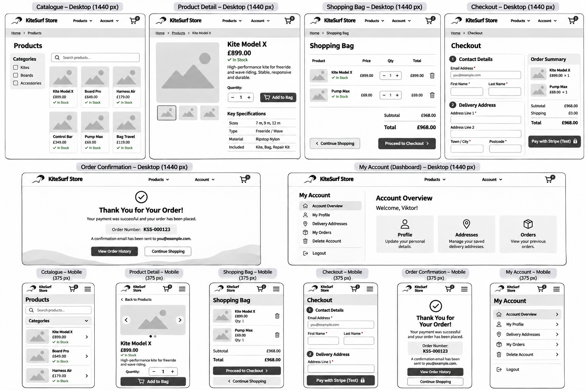
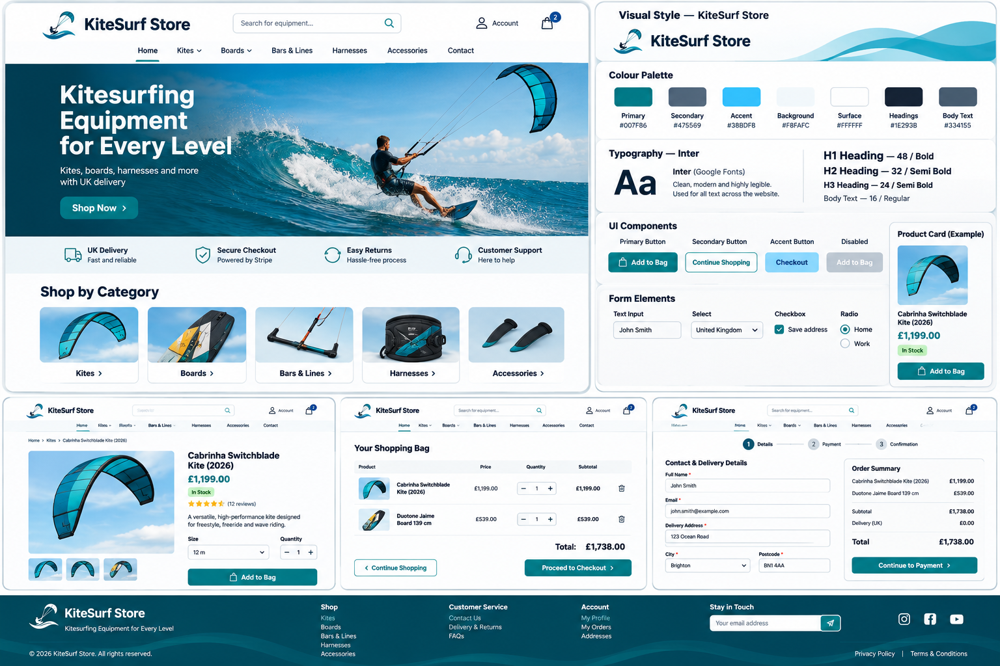
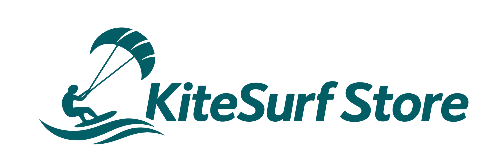
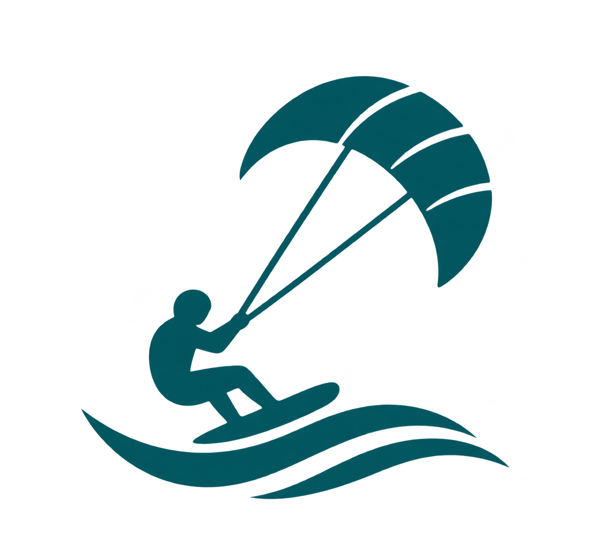
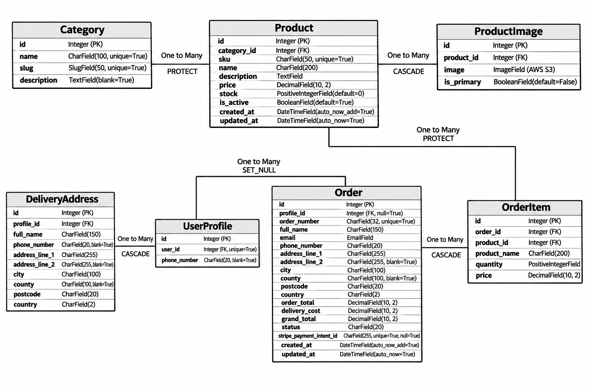

# KiteSurf Store — Kitesurfing Equipment E-commerce Website

**Project Status:** In Development

**Live Website:** https://kitesurf-store-0b61f643c595.herokuapp.com/

## Overview

KiteSurf Store is a planned full-stack e-commerce web application for customers in the United Kingdom who want to browse and purchase kitesurfing equipment online.

The website aims to provide a straightforward shopping experience, allowing customers to explore equipment categories, search and filter products, view detailed product information, manage a shopping cart and complete purchases securely as guests or registered customers.

Payments will be simulated using Stripe Test Mode, as KiteSurf Store is an educational demonstration project that does not process real payments or fulfil physical orders.

Registered customers will be able to view and update their profiles, manage saved delivery addresses, review previous orders and delete their accounts. Product catalogue administration will use Django Admin; a separate staff dashboard is outside the initial project scope.

KiteSurf Store is being developed as an original Django application for the **Gateway Qualifications Level 5 Diploma in Web Application Development — Unit 4: Full Stack Frameworks with Django (F/650/3528)**.

---

## Table of Contents

1. [Project Goals](#project-goals)
2. [Target Audience](#target-audience)
3. [User Stories and Prioritisation](#user-stories-and-prioritisation)
4. [Five Planes of UX](#five-planes-of-ux)
5. [Database Design](#database-design)
6. [Development](#development)
7. [Product Catalogue](#product-catalogue)
8. [AI Tools Usage](#ai-tools-usage)

Additional sections will be added as development progresses.

---

## Project Goals

### Project Purpose

KiteSurf Store is a planned full-stack e-commerce website focused on selling kitesurfing equipment to customers in the United Kingdom.

The aim of the project is to create an accessible, responsive and user-friendly online store that makes it easy for customers to find suitable equipment and complete simulated purchases online.

The project will be developed as an original Django application for Unit 4: Full Stack Frameworks with Django.

### User Goals

- Browse kitesurfing equipment online.
- Find products through clear navigation and product categories.
- Search and filter products.
- Access detailed product information.
- Check product availability.
- Add products to a shopping cart.
- Manage shopping cart contents.
- Complete simulated purchases securely as a guest or registered customer.
- Receive clear feedback about payments and orders.
- Register, verify an email address and recover account access.
- Manage personal account information.
- View previous orders.
- Use the website on mobile, tablet and desktop devices.

### Site Owner Goals

- Present kitesurfing equipment through a professional online storefront.
- Organise products into relevant categories.
- Maintain accurate product information and prices.
- Manage catalogue data through Django Admin.
- Remove discontinued products from the active catalogue.
- Preserve historical order information.
- Keep reliable records of customer orders.
- Provide customers with a straightforward purchasing experience.

### Project Objectives

- Design an intuitive and responsive user interface.
- Develop an original full-stack application using Django.
- Design a relational database to support the store's functionality.
- Implement appropriate user authentication and access controls.
- Provide validated customer-facing CRUD for saved delivery addresses.
- Allow customers to view and update their profiles and delete their accounts securely.
- Integrate simulated online payment processing using Stripe Test Mode.
- Support guest checkout and registered customer checkout.
- Provide email verification, password recovery and order confirmation emails.
- Apply testing throughout development.
- Deploy the completed application to a cloud hosting platform.

---

## Target Audience

KiteSurf Store is aimed at people in the United Kingdom who are interested in purchasing kitesurfing equipment online.

The website is designed with three main customer groups in mind.

### Beginner Kitesurfers

People who are new to kitesurfing and may need additional information before purchasing equipment.

Their main needs include:

- Clear product descriptions.
- Easy navigation between equipment categories.
- Visible prices and product availability.
- A straightforward purchasing process.

### Experienced Kitesurfers

Customers who already understand their equipment requirements and want to find suitable products efficiently.

Their main needs include:

- Quick access to specific equipment.
- Product search and filtering.
- Detailed product specifications.
- An efficient checkout process.

### Returning Customers

Customers who have previously purchased equipment and may want to shop again.

Their main needs include:

- Convenient access to their accounts.
- Easy management of personal information and saved delivery addresses.
- Access to previous orders.
- A consistent shopping experience.

### Business Users

Authorised store staff will maintain the demonstration catalogue using Django Admin. Their needs include accurate product listings, pricing and stock information. A separate staff management dashboard is outside the initial project scope.

### Design Considerations

The needs of these user groups will guide the website's design and development.

The interface will aim to provide clear navigation, readable content, accessible controls and responsive layouts across different screen sizes.

---

## User Stories and Prioritisation

User stories define the planned functionality of KiteSurf Store from the perspective of visitors and registered customers.

The requirements are prioritised using the MoSCoW method:

- **Must Have:** Essential functionality required for the application.
- **Should Have:** Important improvements that support the user experience.
- **Could Have:** Optional features that may be implemented if time allows.
- **Won't Have:** Features excluded from the current project scope.

### Must Have

| ID | User Story |
| --- | --- |
| US01 | As a visitor, I want to browse products so that I can explore the available kitesurfing equipment. |
| US02 | As a visitor, I want to view product details so that I can make informed purchasing decisions. |
| US03 | As a customer, I want to add products to a shopping cart so that I can purchase multiple items together. |
| US04 | As a customer, I want to update quantities and remove products from my cart so that I can control my order. |
| US05 | As a customer, I want to see my order total so that I know how much I will pay. |
| US06 | As a customer, I want to complete a secure simulated online payment so that I can purchase equipment through the demonstration checkout. |
| US07 | As a customer, I want to receive confirmation of successful or unsuccessful payments so that I know the status of my purchase. |
| US08 | As a visitor, I want to register an account so that I can access customer-specific features. |
| US09 | As a registered customer, I want to log in and log out securely so that I can protect my account. |
| US10 | As a registered customer, I want to view and update my profile so that my contact information remains accurate. |
| US11 | As a registered customer, I want to view my previous orders so that I can keep track of my purchases. |
| US12 | As a registered customer, I want to add a delivery address so that I can reuse it during checkout. |
| US13 | As a registered customer, I want to view and edit my saved delivery addresses so that they remain accurate. |
| US14 | As a registered customer, I want to delete an unused delivery address so that I can manage my saved information. |
| US15 | As a registered customer, I want to delete my account securely so that I can stop using the service. |
| US16 | As a user, I want clear validation messages so that I can correct invalid information. |
| US17 | As a user, I want the website to work on different screen sizes so that I can shop using my preferred device. |
| US18 | As a visitor, I want to search for products by name so that I can find specific equipment quickly. |
| US19 | As a visitor, I want to filter products by category so that I can narrow down the catalogue. |
| US20 | As a customer, I want to see product availability so that I know whether an item can be purchased. |
| US21 | As a customer, I want my shopping cart to persist while browsing so that I do not lose selected products. |
| US24 | As a visitor, I want registration and login pages to be available only when I am logged out so that the authentication process is clear and appropriate to my current session. |
| US25 | As a customer, I want my personal information and order history to be accessible only to me so that other customers cannot view my private data. |
| US26 | As a customer, I want to complete checkout either as a guest or as a registered user so that I can choose whether to create an account before purchasing. |
| US27 | As a registered customer, I want to verify my email address so that my account can be confirmed and protected. |
| US28 | As a registered customer, I want to reset my forgotten password so that I can regain access to my account. |
| US30 | As a customer, I want to receive an order confirmation email after successful payment so that I have a record of my purchase. |

### Should Have

No features are currently assigned to this priority. The initial development plan focuses on essential requirements before optional improvements.

### Could Have

| ID | User Story |
|---|---|
| US22 | As a visitor, I want to sort products by price so that I can compare equipment within my budget. |
| US23 | As a customer, I want to see related products so that I can discover additional equipment. |
| US29 | As a visitor, I want to sign in using my Google account so that I can access the website without creating a separate password. |

### Won't Have

The following features are excluded from the initial project scope:

- Product reviews and ratings.
- Customer wishlists.
- Discount codes and loyalty programmes.
- Multiple currencies.
- Advanced inventory management.
- Dedicated staff dashboard and customer-facing product administration.
- Shipping carrier API integrations.

These features may be considered for future development.

### Development Tracking

Each user story is tracked in a GitHub Issue with acceptance criteria and implementation tasks.

Development progress will be documented through Git commits, automated tests and manual testing.

The implementation will prioritise Must Have requirements before optional functionality.

---

## Five Planes of UX

The UX planning for KiteSurf Store follows Jesse James Garrett's Five Planes of User Experience framework.

### 1. Strategy

The purpose of KiteSurf Store is to provide an online shopping experience for customers interested in kitesurfing equipment in the United Kingdom.

The website aims to help customers find suitable equipment, understand product specifications and complete simulated purchases through a straightforward shopping process.

The main business objective is to provide an online storefront with customer-managed account details and reliable order records. Catalogue maintenance will use Django Admin.

The target audience and their needs are described in the [Target Audience](#target-audience) section.

### 2. Scope

The planned functionality is based on the requirements defined in the [User Stories and Prioritisation](#user-stories-and-prioritisation) section.

The essential functional requirements include:

- Product catalogue and individual product pages.
- Product search and category filtering.
- Product availability information and stock quantity validation.
- Session-based shopping cart management.
- Customer registration and authentication.
- Email verification and password recovery.
- Customer profile management.
- Guest and registered customer checkout.
- Secure simulated online payments using Stripe Test Mode.
- Payment confirmation and error feedback.
- Order confirmation emails.
- Customer order history.
- Customer-facing create, read, update and delete operations for saved delivery addresses.
- Secure customer profile updates and account deletion.
- Preservation of historical order information.

The order of features listed above reflects the customer shopping experience rather than development priority.

Implementation priorities are defined in the User Stories and Prioritisation section.

Optional features, including price sorting and related products, will only be considered after essential functionality has been completed.

Google OAuth authentication is also planned as an optional feature and will only be implemented after essential functionality is complete.

### 3. Structure

The Structure plane defines the information architecture, navigation hierarchy and main customer journeys of KiteSurf Store.

#### Sitemap

The sitemap shows the planned customer-facing pages and separates public navigation from authenticated account functionality. Django Admin is a separate staff-only interface.

```text
KiteSurf Store
│
├── Home (/)
├── Products (/products/)
│   ├── Search and Category Filtering
│   └── Product Details
├── Shopping Bag (/bag/)
├── Checkout (/checkout/)
│   ├── Contact and Delivery Details
│   ├── Order Summary
│   ├── Stripe Payment (Test Mode)
│   └── Order Confirmation
├── Accounts (/accounts/)
│   ├── Register
│   ├── Login / Logout
│   ├── Email Verification
│   └── Password Reset
└── My Profile (/profile/) [Authenticated]
    ├── Edit Profile
    ├── Saved Delivery Addresses
    │   ├── Add Address
    │   ├── Edit Address
    │   └── Delete Address
    ├── Order History
    └── Delete Account

Django Admin (/admin/) [Staff Only]
├── Manage Products
├── Manage Categories
└── Manage Orders
```

Search and filtering are catalogue functions, not standalone pages. Guest checkout does not require an account. The paths are indicative and may be refined when Django URL patterns are implemented.

#### Primary Customer Journey

1. Visit the homepage and browse, search or filter products.
2. Open a product detail page and review availability and specifications.
3. Add products to the shopping bag and adjust quantities.
4. Proceed to checkout as a guest or registered customer.
5. Enter or confirm contact and UK delivery details.
6. Complete a simulated payment through Stripe Test Mode.
7. Receive clear payment feedback and, after successful payment, an order confirmation email.

#### Registered Customer Journey

Registered customers can register, verify their email, log in, recover a forgotten password, update their profile, manage saved delivery addresses, view their own order history and delete their account. Google sign-in remains optional (US29).

#### Access and Data Protection

Customer profile, address and order-history pages will require authentication and ownership checks. Historical order information will be preserved independently of saved-address changes or account deletion, subject to the documented personal-data retention policy.

### 4. Skeleton

The Skeleton plane establishes the arrangement of navigation, product content, shopping controls and forms before implementation.

#### Global Layout

- **Desktop:** A visible brand identity, primary navigation, account access and shopping bag access.
- **Mobile:** A compact navigation layout with accessible controls and shopping bag access.
- **Across devices:** Consistent headings, clearly labelled form fields, visible validation feedback and responsive product cards.

#### Page Wireframes

Low-fidelity wireframes were created during PLAN02 to explore the main page layouts and user journeys. They are design references, not evidence that the features have already been implemented.

**Home page wireframe**


**Store pages wireframes**



The store-page wireframes illustrate the intended layout for product discovery, product details, shopping bag, checkout, order confirmation and customer account management. The implemented interface may be simplified to meet assessment requirements and the available development time.

#### Key Interaction Decisions

- Product cards provide clear paths to product details.
- Product pages show prices, availability and an add-to-bag action.
- The shopping bag shows quantities, item totals and the overall total.
- Checkout collects necessary contact and delivery details and displays an order summary.
- Payment outcomes provide clear success or failure feedback.
- Account pages separate personal details, saved addresses and order history.

### 5. Surface

The Surface plane establishes the visual identity of KiteSurf Store. The design direction was selected during PLAN02 to create a clear, consistent and accessible shopping experience inspired by coastal environments and kitesurfing.

#### Visual Design Reference

The visual design reference illustrates the proposed homepage, product detail page, shopping bag, checkout, header, footer and reusable interface elements. It is a concept mockup rather than a screenshot of implemented functionality.



The final website will be built with Django templates, Bootstrap 5 and custom CSS. Components shown in the concept image are illustrative; only functionality defined in the prioritised user stories is in scope. In particular, reviews, newsletter subscriptions and other decorative example features are not planned requirements.

#### Colour Palette

A light **Coastal Minimal** palette was selected, using teal as the primary brand colour, complemented by slate, sky blue and neutral backgrounds.

| Role | Colour | HEX | Intended Use |
| --- | --- | --- | --- |
| Primary | Teal | `#007F86` | Primary buttons, links and brand accents |
| Secondary | Slate | `#475569` | Secondary interface details and icons |
| Accent | Sky Blue | `#38BDF8` | Limited decorative highlights |
| Background | Cool White | `#F8FAFC` | Main page backgrounds |
| Surface | White | `#FFFFFF` | Cards, forms and content panels |
| Headings | Charcoal | `#1E293B` | Headings and prominent text |
| Body Text | Dark Grey | `#334155` | Paragraphs, labels and descriptions |

White or near-white backgrounds will dominate the interface. The header will use a light background; the footer may use a darker teal treatment for visual separation. Text and interactive states will be checked for sufficient contrast during implementation and testing.

#### Typography

**Inter** is used for headings, navigation, buttons, form labels and body text. The Inter variable font is self-hosted in `static/fonts/InterVariable.woff2` rather than loaded from a third-party font CDN.

The font was integrated during PLAN06 and its delivery through Amazon S3 was verified in the browser. The SIL Open Font License 1.1 is retained in `static/fonts/LICENSE.txt`.

The planned type hierarchy is:

| Element | Planned Style |
| --- | --- |
| Main page heading (H1) | Inter Bold, approximately 48px on desktop |
| Section heading (H2) | Inter SemiBold, approximately 32px on desktop |
| Subheading (H3) | Inter SemiBold, approximately 24px on desktop |
| Body text | Inter Regular, approximately 16px |

Font sizes will scale responsively for smaller screens.

#### Branding and Logo

The KiteSurf Store logo was created with **OpenAI ChatGPT image generation** using project-specific instructions. The concept depicts a kitesurfer, kite and waves in the brand's teal colour. Two versions were generated: a horizontal logo with the **KiteSurf Store** wordmark and a standalone symbol without text.

The logos were requested with transparent backgrounds for flexible use in the header and other brand elements. They are AI-generated raster artwork, not manually constructed vector files. Any final assets will be checked for transparency, legibility at small sizes and suitability for web use before deployment.

No existing third-party logo was intentionally copied. AI-generated artwork is not guaranteed to be unique, and references to real equipment brands in the design concept do not imply affiliation or endorsement.

**Primary Logo**



**Compact Logo**



#### Interface Components

Bootstrap 5 will provide the base for navigation, responsive grids, buttons, cards, forms and feedback messages. A small custom stylesheet will apply the selected palette, Inter typography and consistent spacing.

- **Header:** Light navigation bar with the brand logo, catalogue navigation, account access and shopping bag access.
- **Buttons:** Teal primary actions, outlined secondary actions and clearly visible hover, focus and disabled states.
- **Product cards:** Product image, name, price and availability, with clear navigation to product details.
- **Forms:** Consistent labels, inputs and validation messages.
- **Shopping bag and checkout:** Clear order totals, quantity controls and prominent checkout actions.
- **Footer:** Brand identity and relevant site navigation, without introducing features outside the agreed scope.

#### Responsive Design and Accessibility

The interface will follow a mobile-first approach using Bootstrap 5 responsive utilities and layouts. Navigation, product grids, forms and checkout content will adapt to mobile, tablet and desktop screens.

Implementation and testing will cover semantic HTML, meaningful image alternatives, keyboard navigation, visible focus indicators, associated form labels, validation feedback and adequate colour contrast. The design reference does not itself establish accessibility compliance; this will be verified against the implemented pages.

#### Design Scope

The wireframes and visual design concept are planning artefacts. Optional elements appearing in these images do not become project requirements. Implementation remains governed by the [User Stories and Prioritisation](#user-stories-and-prioritisation) section; price sorting (US22), related products (US23) and Google sign-in (US29) remain optional.

---

## Database Design

KiteSurf Store uses a relational database designed to support product management, customer accounts, saved delivery addresses and online orders.

The planned database contains seven custom Django models:

- `Category`
- `Product`
- `ProductImage`
- `UserProfile`
- `DeliveryAddress`
- `Order`
- `OrderItem`

Django's built-in `User` model handles authentication and is linked to `UserProfile` through a one-to-one relationship.

### Entity Relationship Diagram



### Database Relationships

- **Category → Product:** One category can contain multiple products (`PROTECT`).
- **Product → ProductImage:** One product can have multiple images (`CASCADE`). Product images will be stored in Amazon S3.
- **Product → OrderItem:** Products referenced by orders are protected from deletion (`PROTECT`).
- **User → UserProfile:** Each registered customer has one profile.
- **UserProfile → DeliveryAddress:** Customers can save multiple delivery addresses (`CASCADE`).
- **UserProfile → Order:** Customers can have multiple orders. Guest orders do not require an account (`SET_NULL`).
- **Order → OrderItem:** Each order contains purchased products (`CASCADE`).

### Design Decisions

- Each equipment size is represented by a separate `Product` record.
- Product availability is determined by `stock` and `is_active`.
- Products can have multiple images, with one primary image per product.
- Shopping bag contents are stored in Django Sessions rather than a database model.
- `DeliveryAddress` supports customer-facing CRUD with ownership checks.
- Orders preserve delivery details, product names, prices and quantities.
- Guest checkout is supported through an optional relationship between `Order` and `UserProfile`.
- Stripe Test Mode is used for simulated payments.
- Planned order statuses are `PENDING`, `PAID`, `CANCELLED` and `EXPIRED`.

### Data Integrity and Payment Handling

Django ORM relationships and database constraints will maintain data consistency.

Product stock will be validated on the server before checkout. Stock will be reserved when a pending order and its Stripe Checkout Session are successfully established.

The application will use four order statuses:

- `PENDING` — Awaiting payment confirmation.
- `PAID` — Payment successfully confirmed by Stripe.
- `CANCELLED` — Checkout cancelled and reserved stock released.
- `EXPIRED` — Stripe Checkout Session expired and reserved stock released.

Payment confirmation will rely on verified Stripe webhooks rather than browser redirects.

Database transactions and idempotent order status transitions will prevent overselling, duplicate payment processing and repeated stock adjustments.

Cancelled or expired checkout sessions will release reserved stock only once. Paid orders will retain their stock deduction.

Historical orders will preserve product names, quantities, prices and delivery details independently of subsequent changes to products, saved addresses or customer accounts.

These rules describe the planned implementation and will be verified during checkout development.

---

### Catalogue Models Implementation

The catalogue database models were implemented during PLAN05 using Django ORM.

Three custom models have been defined in `products/models.py`:

- `Category`
- `Product`
- `ProductImage`

The implementation follows the Entity Relationship Diagram (ERD), with additional model-level constraints and properties to support catalogue functionality.

#### Category

The `Category` model organises products into equipment categories.

- `name` — unique category name.
- `slug` — unique URL-friendly identifier.
- `description` — optional category description.

Categories are ordered alphabetically by name.

#### Product

The `Product` model stores equipment information, pricing, stock availability and catalogue visibility.

- `category` — required foreign key to `Category`, using `PROTECT`.
- `sku` — required unique product identifier.
- `name` — product name.
- `description` — product description.
- `price` — product price in GBP.
- `stock` — available quantity, defaulting to zero.
- `is_active` — controls catalogue visibility.
- `created_at` — automatically records creation time.
- `updated_at` — automatically records modification time.

Each equipment size is represented by a separate product record with its own SKU, price and stock quantity.

Product detail pages will use database IDs rather than product slugs.

The model includes:

- `primary_image` — returns the primary product image, if available.
- `is_available` — returns `True` when the product is active and has stock.
- `CheckConstraint` — requires product prices to be greater than zero.

Products are ordered by creation date, newest first.

#### ProductImage

The `ProductImage` model supports multiple images for each product.

- `product` — foreign key to `Product`, using `CASCADE`.
- `image` — Django `ImageField` configured to upload to `products/`.
- `is_primary` — identifies the primary product image.

A conditional `UniqueConstraint` prevents more than one image from being marked as primary for the same product.

Product images will use Amazon S3 when the configured AWS storage backend is enabled.

#### Catalogue Data Integrity

The models implement the following rules:

- Every product must belong to a category.
- Categories containing products cannot be deleted.
- Each product must have a unique SKU.
- Product prices must be greater than zero.
- Stock quantities cannot be negative.
- Product availability is determined by stock quantity and active status.
- Out-of-stock products can remain visible in the catalogue.
- Inactive products will be excluded from the public catalogue.
- Each product can have multiple images but no more than one primary image.
- Deleting a product cascades to its related `ProductImage` database records.
- Products referenced by historical orders will be protected from deletion when the `OrderItem` relationship is implemented.

These rules are implemented through Django model fields, database constraints and model properties. Catalogue filtering and public product visibility were subsequently implemented and tested during PLAN07.

#### Implementation Status

**Status:** Completed — PLAN05 (10 November 2026).

The catalogue data layer and Django Admin functionality have been implemented and verified.

Completed work:

- Implemented `Category`, `Product` and `ProductImage` models.
- Created and applied the `products.0001_initial` migration to Neon PostgreSQL.
- Implemented database constraints for product prices, unique SKUs and primary image uniqueness.
- Configured Django Admin for category and product management.
- Implemented inline product image management.
- Added validation preventing multiple primary images per product.
- Implemented safe primary image switching.
- Verified primary image deletion.
- Added product image thumbnail previews in Django Admin.
- Integrated AWS S3 for product image uploads and storage.

**Automated testing:**

- 28 tests passed using SQLite in-memory.
- Django system checks passed with no issues.
- Database migration consistency verified.

**Manual testing:**

- Product image uploads to AWS S3 verified.
- Product image URLs verified.
- Image thumbnail previews verified in Django Admin.
- Primary image switching verified.

The primary image switching issue was documented and resolved in GitHub Issue #37.

Customer-facing catalogue views, product search and category filtering were subsequently implemented during PLAN07.

Individual product detail pages remain part of the next development stage.

## Development

### Development Environment

KiteSurf Store is being developed using Python 3.12.11 and Django 5.2.19.

The application uses a shared Neon PostgreSQL database for both local development and the deployed Heroku environment.

SQLite in-memory is configured separately for fast, isolated automated testing.

The application is deployed to Heroku, with Amazon S3 used for static files and product images.

Static file delivery, product image uploads, image previews and primary image switching have been successfully verified both locally and on Heroku.

The catalogue database models, migrations, Django Admin functionality and AWS S3 media integration were completed during PLAN05.

### Shared Layout and Design System

**Status:** Completed — PLAN06 (11 November 2026).

The shared layout and design system were implemented using Django Templates, Bootstrap 5.3.3 and custom CSS.

#### Template Structure

The application uses reusable Django templates to provide consistent navigation and styling across pages.

- `templates/base.html` — shared HTML structure, Bootstrap integration and reusable template blocks.
- `templates/includes/header.html` — responsive navigation and brand logos.
- `templates/includes/footer.html` — shared footer.
- `templates/home.html` — homepage extending the base template.
- `config/views.py` — homepage view.
- `config/urls.py` — homepage URL configuration.

The homepage is available at `/`.

#### Responsive Navigation

The header uses Bootstrap's responsive navbar component.

- Below 576px: compact logo and collapsible navigation menu.
- From 576px: full logo and horizontal navigation.
- The navigation toggle opens and closes the mobile menu.
- The brand logo links to the homepage.

Both logo variants use optimised WebP images stored in `static/images/`.

#### Design System

The shared stylesheet is located at `static/css/styles.css`.

Implemented styling includes:

- Coastal Minimal colour palette defined through CSS custom properties.
- Self-hosted Inter variable font.
- Responsive heading typography.
- Customised Bootstrap primary and outline-primary buttons.
- Consistent navigation and footer styling.
- Visible keyboard focus indicators.

The Inter font is stored in `static/fonts/InterVariable.woff2`.

The font is distributed under the SIL Open Font License 1.1, with the licence retained in `static/fonts/LICENSE.txt`.

#### Static Asset Delivery

Static assets are collected using Django's `collectstatic` command and uploaded to Amazon S3 when AWS storage is enabled.

The following assets have been verified:

- Custom CSS stylesheet.
- Inter variable font.
- Primary WebP logo.
- Compact WebP logo.

The Inter font was confirmed to load successfully from Amazon S3 in the browser.

#### Testing and Verification

| Check | Result |
| --- | --- |
| Django automated tests | PASS — 38 tests |
| Django system checks | PASS — 0 issues |
| Homepage rendering | PASS |
| Shared template rendering | PASS |
| Header and footer rendering | PASS |
| Responsive navigation | PASS — manual verification |
| Mobile menu toggle | PASS — manual verification |
| Brand logo display | PASS — manual verification |
| Inter font delivery from AWS S3 | PASS |
| Static file collection | PASS |

Primary and outline-primary button styles have been implemented but have not yet been visually verified on a page containing these buttons.

**Result:** The shared layout and design system are implemented and ready for use by subsequent application features.

### Technologies and Services

| Technology | Purpose |
| --- | --- |
| Python 3.12.11 | Backend programming language |
| Django 5.2.19 | Web application framework |
| PostgreSQL (Neon) | Shared development and deployed application database |
| SQLite in-memory | Fast automated testing |
| Django Templates | Server-rendered HTML |
| Bootstrap 5 | Responsive user interface |
| JavaScript | Client-side functionality |
| AWS S3 | Static and product media file storage (verified) |
| Heroku | Application hosting (initial deployment verified) |
| Stripe Test Mode | Planned simulated payment processing |
| django-storages and boto3 | Django integration with Amazon S3 |
| Gunicorn | Production application server |

### Local Setup

To run the project locally:

1. Clone the repository:

   ```bash
   git clone https://github.com/ShvetsViktor/kitesurf-store.git
   cd kitesurf-store
   ```

2. Create a Python 3.12.11 virtual environment:

   ```bash
   python3.12 -m venv .venv
   ```

3. Activate the virtual environment:

   **macOS / Linux:**

   ```bash
   source .venv/bin/activate
   ```

   **Windows:**

   ```powershell
   .venv\Scripts\Activate.ps1
   ```

4. Install dependencies:

   ```bash
   pip install -r requirements.txt
   ```

5. Create a `.env` file in the project root and configure the required environment variables:

   ```dotenv
   SECRET_KEY=your-django-secret-key
   DATABASE_URL=your-neon-postgresql-connection-string
   DEVELOPMENT=1
   ```

   Replace the placeholder values with your own credentials.

   The `.env` file is excluded from version control and must never be committed to GitHub.

6. Apply database migrations:

   ```bash
   python manage.py migrate
   ```

7. Start the development server:

   ```bash
   python manage.py runserver
   ```

   The development server uses the PostgreSQL database configured through `DATABASE_URL`.

### Database Configuration

The application uses Neon PostgreSQL, a managed cloud PostgreSQL service.

Database credentials are stored in environment variables rather than committed to the repository.

Django loads the local `.env` file using `python-dotenv` and configures the database connection using `dj-database-url`.

Initial Django migrations have been applied successfully to the development PostgreSQL database.

### Automated Testing

KiteSurf Store follows a test-driven development (TDD) approach where practical.

Automated tests are implemented using Django's built-in testing framework.

#### Test Database

The project uses SQLite in-memory for automated testing.

This configuration provides fast, isolated test execution without modifying the Neon PostgreSQL development database.

Database migrations are applied automatically when the test database is created.

#### Running Tests

Run the complete Django test suite:

```bash
python manage.py test
```

Run product application tests:

```bash
python manage.py test products --verbosity=2
```

Check Django configuration:

```bash
python manage.py check
```

Check migration consistency:

```bash
python manage.py makemigrations --check --dry-run
```

#### PLAN05 Test Results — 10 November 2026

| Test Group | Tests | Result |
| --- | ---: | --- |
| Category model | 4 | PASS |
| Product model | 8 | PASS |
| ProductImage model | 4 | PASS |
| Django Admin | 12 | PASS |
| **Total** | **28** | **PASS** |

Additional verification:

| Check | Result |
| --- | --- |
| Django system checks | PASS — 0 issues |
| SQLite in-memory test database | PASS |
| Initial catalogue migration | PASS |
| Migration consistency | PASS |
| AWS S3 product image uploads | PASS — manual verification |
| AWS S3 product media delivery on Heroku | PASS — manual verification |
| Django Admin image previews | PASS — automated and manual verification |
| Primary image switching | PASS — automated and manual verification |

**Final result:** 28 automated tests passed in 1.165 seconds.

#### TDD Regression Testing

During Django Admin development, automated tests identified two issues:

1. Selecting multiple primary images caused a database `IntegrityError`.
2. Switching the primary image could violate the database uniqueness constraint depending on inline form save order.

The issues were resolved by:

- Implementing custom inline formset validation.
- Updating the product admin formset saving logic.
- Preserving database-level uniqueness constraints.
- Adding regression tests for both primary image switching orders.

The bug was documented in GitHub Issue #37 and closed after successful regression testing.

Additional automated tests will be added as customer-facing functionality is implemented.

### Environment Variables and Security

Sensitive settings are managed through environment variables.

The following files and directories are excluded from version control:

- `.env` and other local environment files
- `.venv/`
- `__pycache__/`
- Local SQLite database files
- Generated static and media files

Django's development mode is controlled by the `DEVELOPMENT` environment variable.

The production environment will not define this variable, ensuring that Django debug mode is disabled.

### AWS S3 Configuration

Amazon S3 is configured for website static assets and uploaded product images. The configuration was adapted from the Code Institute Boutique Ado tutorial for **Django 5.2**, which uses `STORAGES` rather than the removed `STATICFILES_STORAGE` and `DEFAULT_FILE_STORAGE` settings.

#### AWS Resources and Access

- S3 bucket created and configured.
- IAM policy created to permit the required S3 operations.
- Dedicated IAM user created, with the policy attached directly.
- AWS access credentials stored as Heroku Config Vars rather than committed to Git.
- Public website assets are served from S3; personal customer data must not be stored in the public asset locations.

Bucket permissions, ownership and CORS were configured during setup. Access should be limited to what is necessary and reviewed before production use.

#### Django Storage Backends

The project uses `boto3`, `django-storages` and custom `StaticStorage` and `MediaStorage` backends.

When `USE_AWS` is enabled, Django's `STORAGES` setting routes collected static files to the S3 `static/` prefix and uploaded product images to the `media/products/` prefix.

Product image uploads and retrieval have been manually verified through Django Admin.

#### Verified Static File Delivery — 9 November 2026

| Check | Result |
| --- | --- |
| Heroku build | PASS |
| Gunicorn startup and web dyno | PASS |
| `collectstatic` | PASS — 127 static files |
| S3 `static/` files present | PASS |
| Django Admin accessible | PASS |
| Django Admin CSS displayed correctly | PASS |
| Product image upload to S3 | NOT YET TESTED |
| Product image delivery from S3 | NOT YET TESTED |

These checks confirm the initial static-file pipeline: **Django → collectstatic → Amazon S3 → browser**. They do not yet confirm product media uploads.

#### Verified Product Media Storage — 10 November 2026

| Check | Result |
| --- | --- |
| Product image upload through Django Admin | PASS |
| Product image stored in AWS S3 | PASS |
| Product image URL generated correctly | PASS |
| Product image accessible through its media URL | PASS |
| Product image thumbnail displayed in Django Admin | PASS |
| Primary image switching | PASS |
| Primary image deletion | PASS — automated test |
| Static file delivery remains operational | PASS |

These checks confirm that product images can be uploaded, stored and retrieved using the configured AWS S3 media backend.

The implementation supports multiple images per product while enforcing a maximum of one primary image.

### Deployment

KiteSurf Store is deployed to Heroku.

**Live Application:** https://kitesurf-store-0b61f643c595.herokuapp.com/

**Hosting Platform:** Heroku  
**Application Server:** Gunicorn  
**Static and Media Storage:** Amazon S3  
**Initial Deployment:** 9 November 2026

The initial deployment was completed successfully. Heroku build logs confirmed that Django collected and uploaded 127 static files to Amazon S3.

Application logs confirmed that Gunicorn started successfully and the web dyno entered the `up` state.

The Django Admin interface was verified to load correctly, including CSS assets served from Amazon S3.

The customer-facing homepage has been implemented and verified locally during PLAN06. The shared layout includes responsive navigation, brand logos and a footer.

The homepage and shared layout have been deployed and verified on Heroku.

The catalogue models, Django Admin and AWS S3 product media integration have been implemented and tested successfully in both local development and the deployed Heroku environment.

Product image uploads, image previews and primary image switching were manually verified through Django Admin.

The customer-facing product catalogue, including product search and category filtering, was implemented, tested and deployed during PLAN07.

The catalogue was manually verified on Heroku on 12 November 2026. Product listings, images, fallback images, stock availability, search, category filtering and combined filtering work as expected.

Individual product detail pages, customer accounts, shopping bag, checkout and payments remain to be developed.

---

## Product Catalogue

**Status:** Completed and deployed — PLAN07 (12 November 2026).

The customer-facing product catalogue is available at `/products/`.

The catalogue allows visitors to browse kitesurfing equipment, search products by name, filter products by category and check product availability.

### Implementation

The catalogue uses the existing `Category`, `Product` and `ProductImage` Django models.

The product list view is implemented in `products/views.py`.

The interface is implemented in `products/templates/products/product_list.html` and extends the shared `base.html` template.

### Product Visibility

The catalogue displays active products only.

- Active products with stock are displayed as `In stock`.
- Active products without stock remain visible as `Out of stock`.
- Inactive products are excluded from the public catalogue.

Product availability is determined using the existing `Product.is_available` property.

### Search and Category Filtering

Visitors can search for products by name using a GET request.

The search uses Django ORM's `icontains` lookup to perform case-insensitive matching.

Category filtering uses the category slug.

Both filters can be applied simultaneously.

The catalogue uses the following query parameters:

| Parameter | Purpose | Example |
| --- | --- | --- |
| `q` | Search by product name | `?q=kite` |
| `category` | Filter by category slug | `?category=boards` |
| `q` and `category` | Combine search and filtering | `?q=surf&category=boards` |

Search input is stripped of leading and trailing whitespace.

The selected category and search query remain populated after form submission.

Invalid category slugs return an empty product list rather than causing a server error.

### Product Cards

Each product card displays:

- Primary product image.
- Product name.
- Price in GBP.
- Stock availability badge.

If a product has no primary image, the catalogue displays the fallback image:

`static/images/default-image-fallback.webp`

Product images are retrieved through the configured Django storage backend, using Amazon S3 when AWS storage is enabled.

The interface uses Bootstrap's responsive grid and card components.

### Empty States

The catalogue displays appropriate feedback when no products are available.

- `No products available.` — the catalogue contains no active products.
- `No products match your search or filters.` — search or filtering produces no matching products.

### Automated Testing

Automated tests use Django's built-in testing framework and SQLite in-memory.

The catalogue tests cover:

- Catalogue URL and HTTP response.
- Template rendering.
- Active and inactive product visibility.
- Out-of-stock product visibility.
- Case-insensitive product search.
- Category filtering.
- Combined search and category filtering.
- Invalid category handling.
- Empty catalogue and no-results states.
- Product names and prices.
- Stock availability labels.

#### Test Results — 12 November 2026

| Check | Result |
| --- | --- |
| Complete Django test suite | PASS — 63 tests |
| Django system checks | PASS — 0 issues |
| SQLite in-memory test database | PASS |

The complete test suite was executed using:

`python manage.py test`

### Manual Functional Testing

Manual testing was performed locally in the browser.

| Test | Result |
| --- | --- |
| Product names and prices | PASS |
| In-stock and out-of-stock labels | PASS |
| Inactive product exclusion | PASS |
| Product images and fallback image | PASS |
| Full product name search | PASS |
| Partial and case-insensitive search | PASS |
| Category filtering | PASS |
| Combined search and filtering | PASS |
| Empty search results | PASS |
| Resetting search and filters | PASS |
| Search whitespace handling | PASS |
| Search and category selection persistence | PASS |

### Accessibility Review

The catalogue template was reviewed for semantic HTML and accessible form controls.

| Check | Result |
| --- | --- |
| Search input has an associated label | PASS |
| Category filter has an associated label | PASS |
| Product images have alternative text | PASS |
| Semantic HTML structure | PASS — code inspection |

The search form uses `role="search"`.

Form labels use Bootstrap's `visually-hidden` class to remain accessible to assistive technologies.

### Known Limitations

- Individual product detail pages are not yet implemented.
- Product cards do not yet provide navigation to individual product pages.
- Shopping bag and checkout functionality are not yet implemented.
- Price sorting and related products remain optional features.

### Deployment Status

**Status:** Deployed and verified — 12 November 2026.

The product catalogue was merged into `main` and successfully deployed to Heroku.

**Live Catalogue:** https://kitesurf-store-0b61f643c595.herokuapp.com/products/

#### Production Verification

Manual functional testing was performed on the deployed Heroku application.

| Check | Result |
| --- | --- |
| Catalogue page loads successfully | PASS |
| Product names and prices display correctly | PASS |
| In-stock and out-of-stock labels | PASS |
| Inactive products are excluded | PASS |
| Product images load from AWS S3 | PASS |
| Fallback images display correctly | PASS |
| Product name search | PASS |
| Case-insensitive and partial search | PASS |
| Category filtering | PASS |
| Combined search and category filtering | PASS |
| Empty search results | PASS |
| Search and filter values persist | PASS |

**Result:** The deployed catalogue behaves as expected and matches the locally tested implementation.

PLAN07 is complete.

---

## AI Tools Usage

### Wireframe Design

OpenAI ChatGPT image generation was used to create initial desktop and mobile wireframes based on the project's sitemap, requirements and UX decisions. The layouts were reviewed and simplified to avoid adding functionality beyond the agreed user stories.

### Logo and Visual Design

OpenAI ChatGPT image generation was also used to create the KiteSurf Store logo concepts, the standalone kitesurfer symbol and the visual style-guide mockup. The user selected the teal-based Coastal Minimal palette and Inter typography after reviewing alternatives. AI-assisted images were used for design exploration; the website's functional interface will be implemented in HTML, CSS, Bootstrap and Django templates rather than embedding the mockup as a page image.

The visual concept includes illustrative product images and names. These are design placeholders, not verified photographs or accurate specifications of products for sale. Any third-party product imagery used in the finished site will require appropriate usage rights and attribution where applicable.
